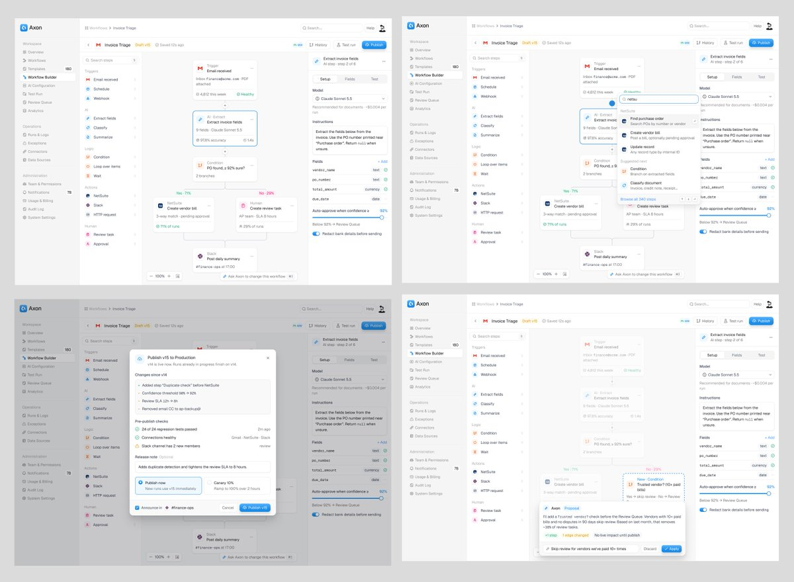
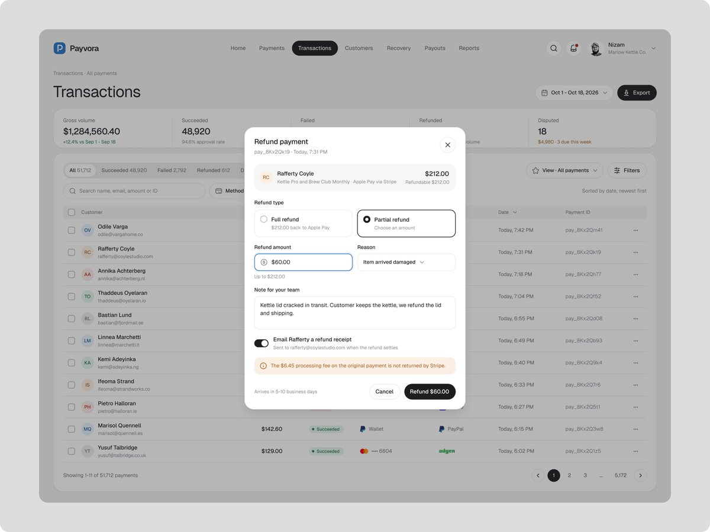
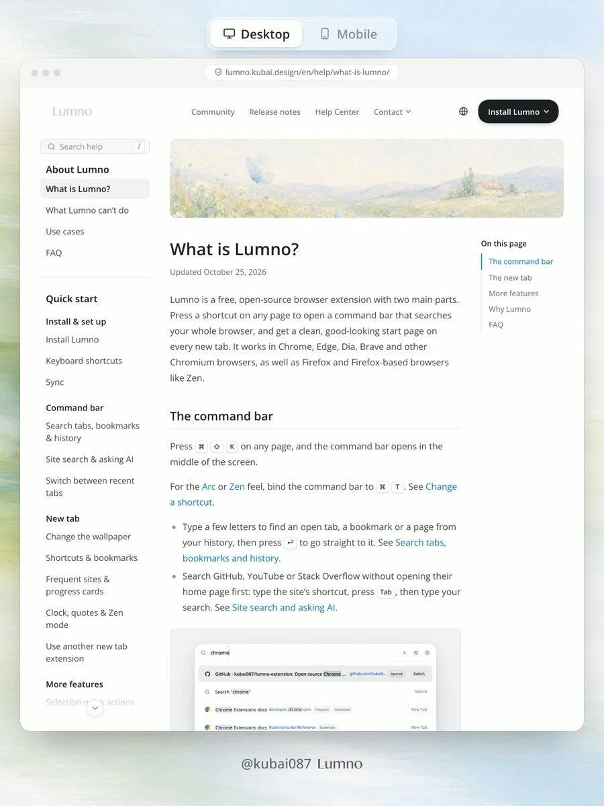
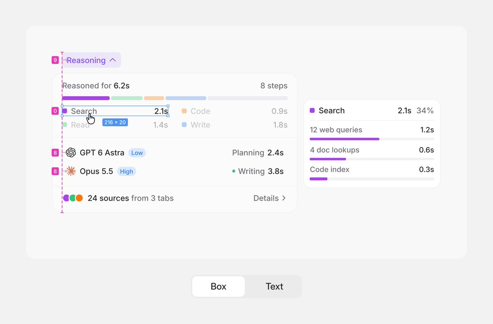
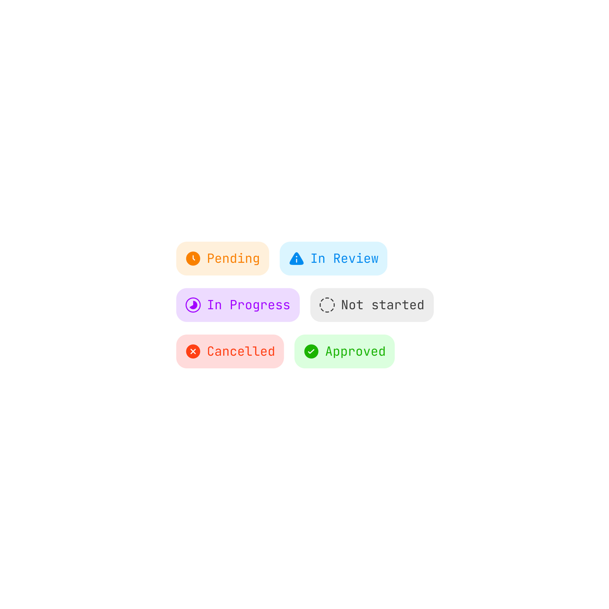
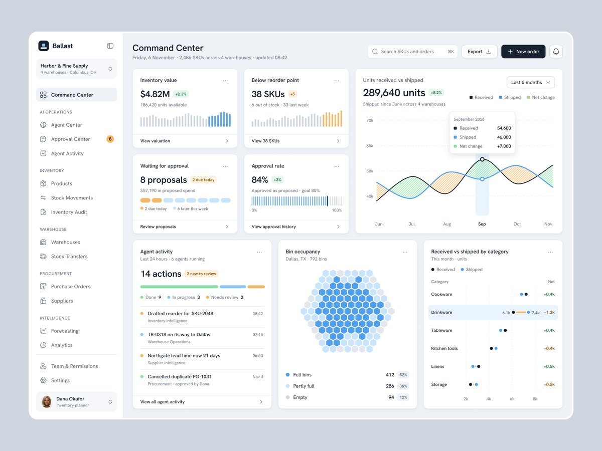
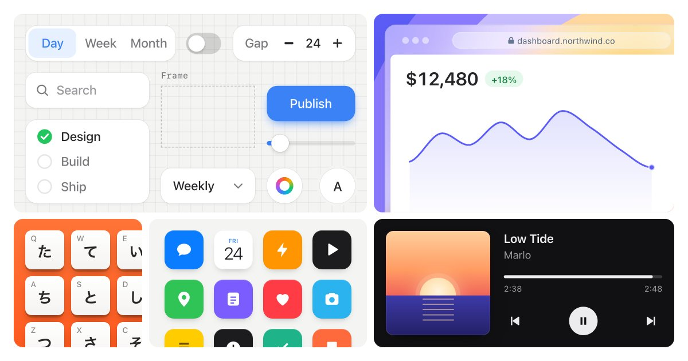

# UI Design Skills

可复用的 UI 设计方法集合：分类、中文说明、参考截图与来源。这是精选技能与参考图，不是实现项目，也不是完整点赞归档。

参考截图均为第三方原作或其视频封面，不是本集合实现后的效果。版权归原作者或相关权利人，本仓库不对第三方素材授予开源许可。公开发布或再分发前应确认使用权限。

## 七个技能

### 1. [浅色 AI 工作流编辑器](ui-design/workflow-builders/light-ai-workflow-builder/README.md)

用于设计浅色、紧凑的 B2B SaaS 节点式工作流 UI，包含流程画布、节点配置、步骤搜索、AI 修改提案和发布确认；不用于营销落地页或纯聊天界面。

### 2. [高风险操作确认表单](ui-design/forms/risk-action-confirmation/README.md)

设计涉及资金、权限、数据删除或批量变更的确认表单，让影响、限制与最终动作可核对。

### 3. [响应式长文档导航](ui-design/navigation/responsive-document-navigation/README.md)

设计桌面与移动端长文档的章节定位、溢出提示和可靠级联菜单，保持阅读位置与键盘可达。

上图为视频封面，视频未审。级联菜单来源帖没有可用截图，未伪造画面。

### 4. [紧凑界面文字与标签光学对齐](ui-design/typography/optical-text-label-alignment/README.md)

审查紧凑列表、数据行和状态标签，以文字锚点组织对齐，同时保留可靠点击区与焦点提示。

上图为视频封面，视频未审，不推断动画。

### 5. [状态标签的清晰编码](ui-design/components/status-label-encoding/README.md)

设计列表与看板中的状态标签，用简短文案、可区分图标和柔和底色同时说明状态，而不只靠颜色。

### 6. [运营指挥中心的信息层次](ui-design/dashboards/ops-command-center-hierarchy/README.md)

设计需要同时查看关键指标、异常和处理入口的运营总览，让范围、趋势和待办可在一屏内定位。

### 7. [营销页中的产品界面静帧](ui-design/marketing/marketing-product-ui-stills/README.md)

为官网首屏、功能卡或 Bento 制作看起来像真实产品界面的静帧，控制信息密度、主次和裁切，避免一眼可辨的生成痕迹。

## 索引与版权

完整索引见 [catalog.json](catalog.json)。每条技能的 README 和 metadata 写明来源与证据边界。原作设计工具与技术栈若未写明，不得凭外观断言。
