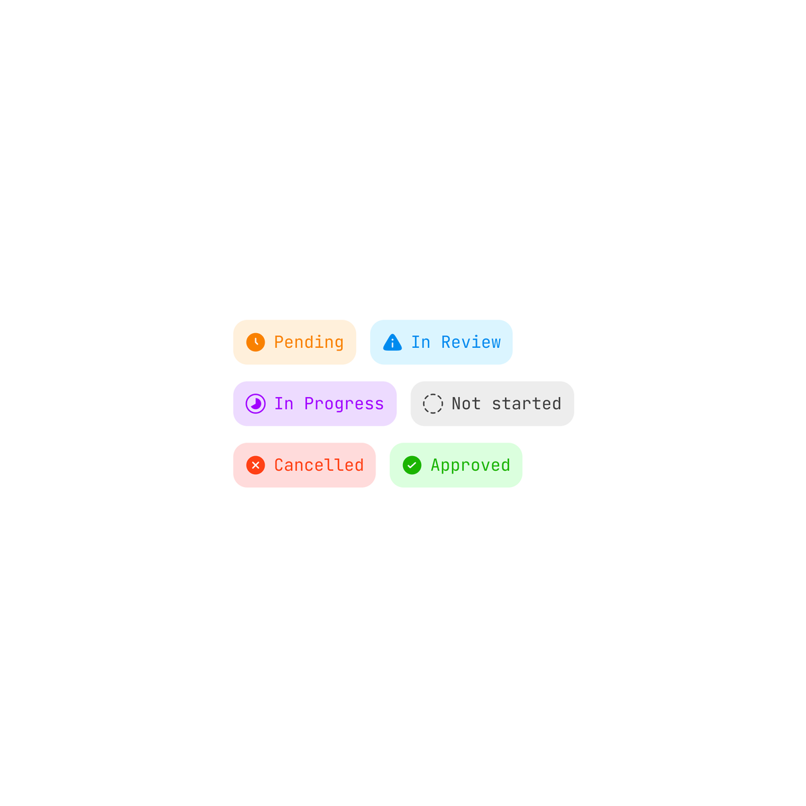

# 状态标签的清晰编码

分类：`ui-design/components`。技能正文见 [SKILL.md](SKILL.md)。

来源：[Adi：Clean labels](https://x.com/AdityaSur11/status/2118734685207732631)。已读静态图：六种状态同时用短名称、图标和浅底色。原文仅“Clean labels”，未说明尺寸、交互或技术栈。参考图非实现效果，版权归原作者或相关权利人。
