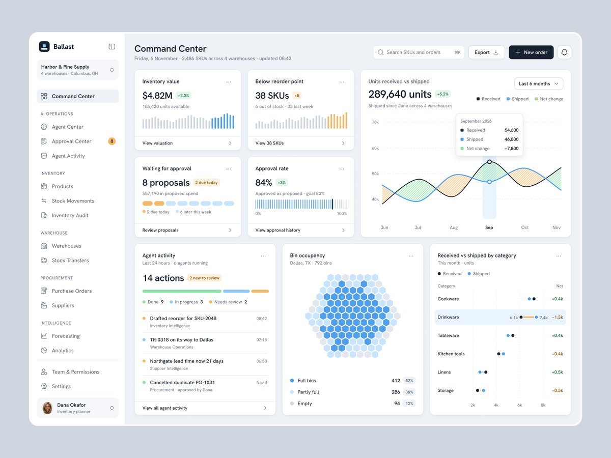

# 运营指挥中心的信息层次

分类：`ui-design/dashboards`。技能正文见 [SKILL.md](SKILL.md)。

来源：[Ilias Miah：Ballast Inventory Command Center](https://x.com/iliasconfidency/status/2118616144546603403)。已读静态总览：分组导航、指标卡、主导趋势、待办和构成说明。图中指标为示例，不是用户数据。未验证悬停、刷新或动效。参考图非实现效果，版权归原作者或相关权利人。
