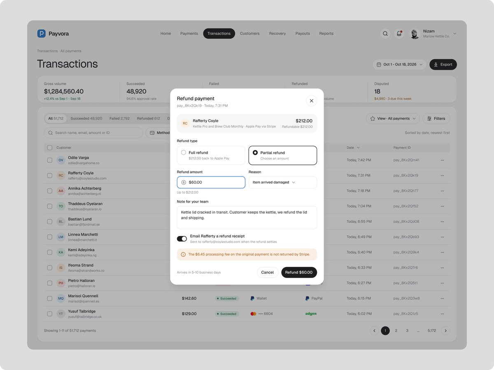

# 高风险操作确认表单

分类：`ui-design/forms`。技能正文见 [SKILL.md](SKILL.md)。

来源：[Nizam 的 Popup design](https://x.com/nizamdesign/status/2119157942490370388)。已读静态图：对象摘要、退款方案、上限、原因、费用警告和具体金额按钮。跨业务推广、异步状态与无障碍规则为扩展建议，不是原作实测。参考图非实现效果，版权归原作者或相关权利人。
