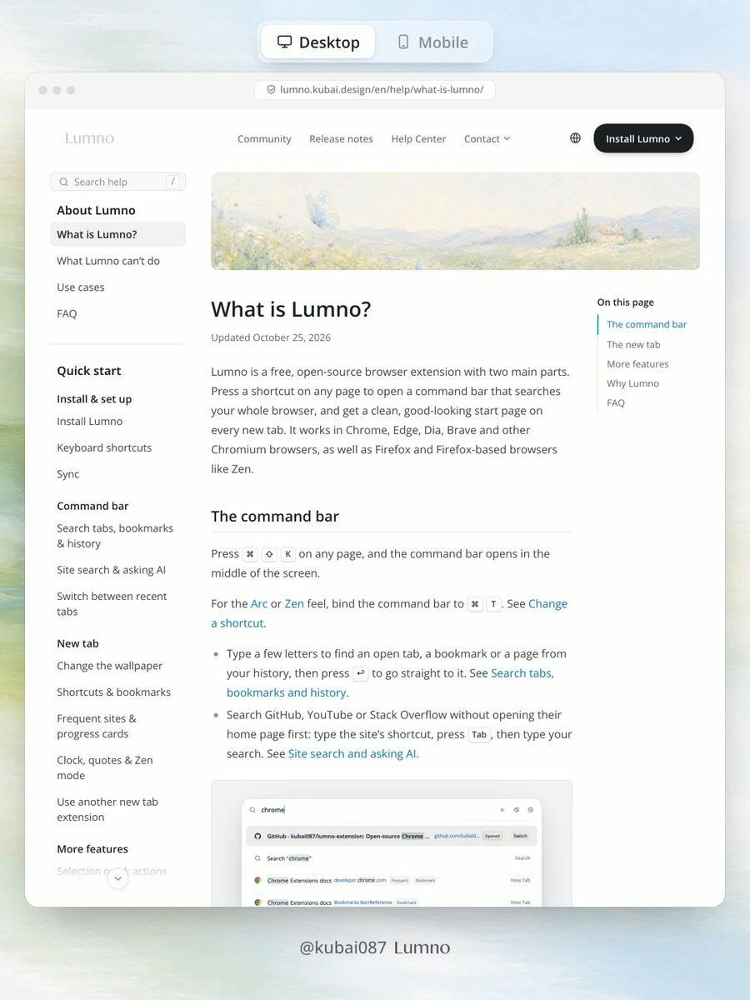

# 响应式长文档导航

分类：`ui-design/navigation`。技能正文见 [SKILL.md](SKILL.md)。

上图是视频封面，视频未审，不能当作已验证的交互动效。

来源：
- [枯白啃设计：Wiki 框架与布局](https://x.com/Kubai087/status/2116911391437443471)（已读完整正文与封面）
- [枯白啃设计：级联菜单安全区](https://x.com/Kubai087/status/2114729985143677258)（已读完整正文；原帖视频/图片下载失败，没有截图，未伪造画面）

原文中的开启/关闭延时等只是作者示例值，不是通用标准。版权归原作者或相关权利人。
