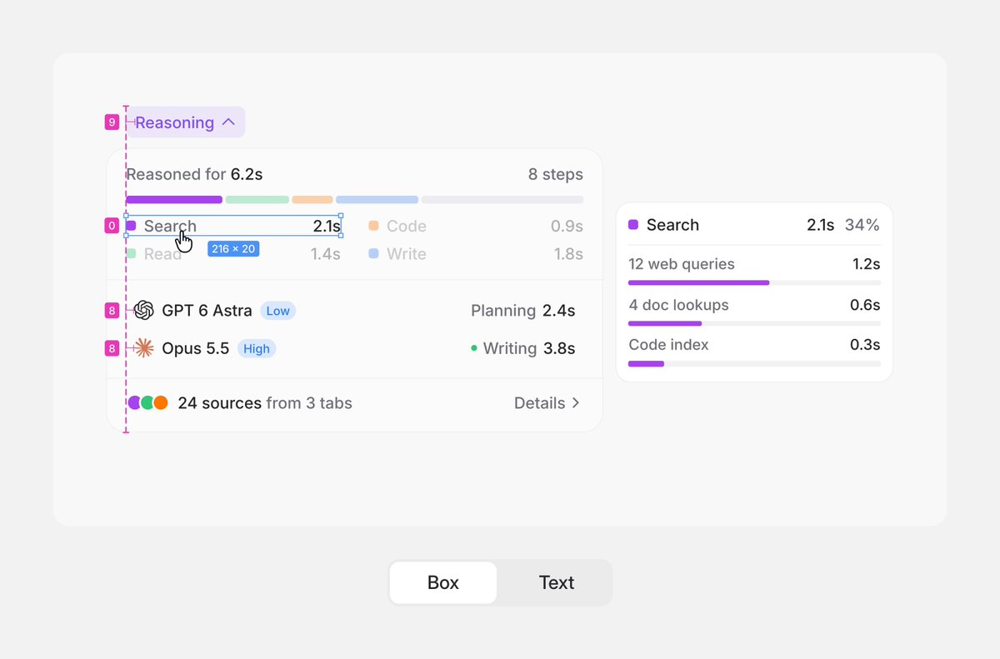

# 紧凑界面文字与标签光学对齐

分类：`ui-design/typography`。技能正文见 [SKILL.md](SKILL.md)。

上图是视频封面，视频未审，不推断动画过程。

来源：[Juliette：Align the text, not the box](https://x.com/shedsgns/status/2114582799072317610)。原则来自作者正文及已查看封面。结构实现与状态覆盖为扩展建议。参考图非实现效果，版权归原作者或相关权利人。
