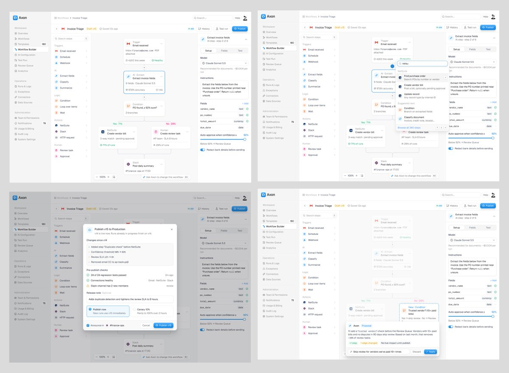
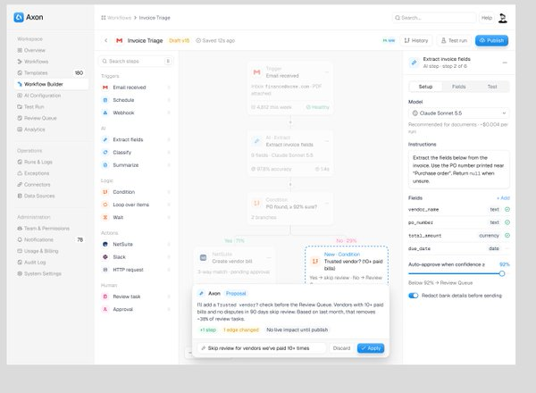

# 浅色 AI 工作流编辑器

分类：`ui-design/workflow-builders`。技能正文见 [SKILL.md](SKILL.md)。

参考截图为第三方原作，不是本集合实现效果。原作工具未知。

| 编辑器 | 插入步骤 |
|---|---|
|  |  |

| 发布确认 | AI 提案 |
|---|---|
|  |  |

来源：[Jubayer 的 workflow builder flow UI](https://x.com/jubayer6910/status/2119054545489969346)，[原始图片](https://pbs.twimg.com/media/HWhkzh6asAAs8cr.jpg)。帖子只写“workflow builder flow UI.”，附四状态拼图。图中品牌与示例数据不能当作真实产品或用户数据。版权归原作者或相关权利人。
